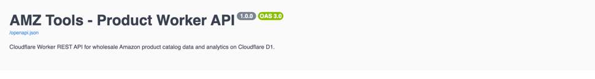
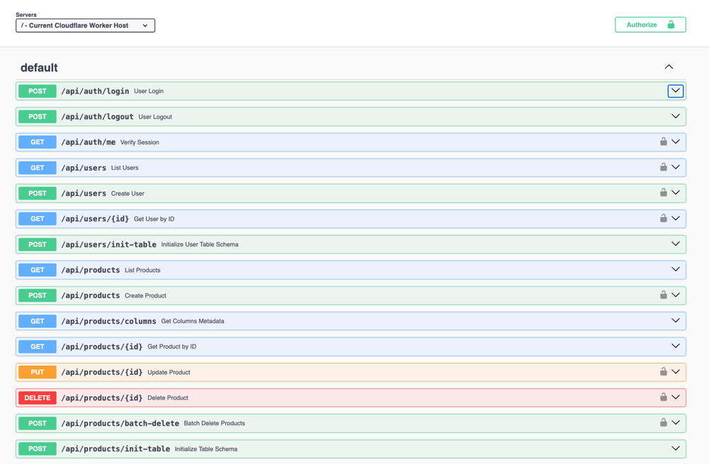
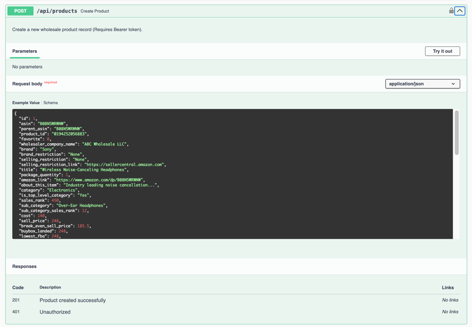
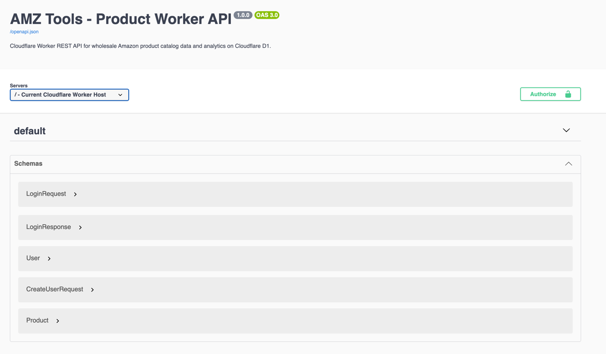
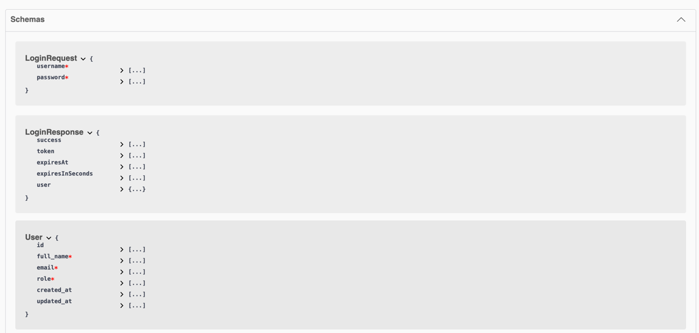
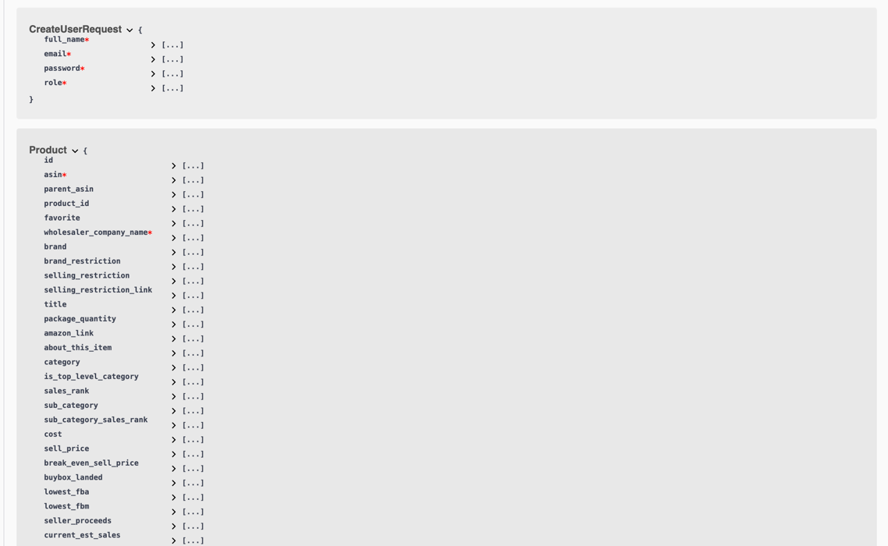

# AMZ Tools - Product Worker API (Backend)

Cloudflare Worker REST API built with [Hono](https://hono.dev/) and backed by **Cloudflare D1** serverless SQLite database.

## Features
- **Product CRUD API**: Full Create, Read, Update, Delete for all 67 wholesale product catalog columns.
- **Authentication**: Simple username & password login configured in code (`admin` / `password123`), issuing a stateless HMAC-SHA256 JWT session token valid for **1 week (7 days)**.
- **Data Table Optimization**:
  - Pagination (50, 100, 150 items per page).
  - Global fuzzy search across key identifiers (ASIN, Title, Brand, Wholesaler, UPC, Category).
  - Sorting on any column (`sortBy` + `sortOrder`).
  - **Per-column filters**: Direct search and numeric range filtering (`_min` and `_max`) on all columns.
  - Column metadata endpoint (`/api/products/columns`).
- **Interactive Swagger Documentation**: Built-in OpenAPI 3.0 specification available at `/openapi.json` and interactive Swagger UI at `/docs`.
- **D1 Schema Auto-Init**: Built-in endpoint (`POST /api/products/init-table`) to create the `wholesale_products` table and performance indexes on D1 if not existing.

---

## Configuration (`wrangler.toml`)

```toml
name = "product-backend"
main = "index.js"
compatibility_date = "2026-09-06"

[[d1_databases]]
binding = "DB"
database_name = "amztools"
database_id = "aa1f6d2b-e14b-4e20-8d69-e02d2673a478"
```

---

## Authentication Credentials

Configured in `src/config.js` (can also be overridden by Worker environment variables `ADMIN_USERNAME` and `ADMIN_PASSWORD`):
- **Username:** `admin`
- **Password:** `password123`
- **Session Duration:** 7 days (604,800 seconds)

Protected endpoints (Create, Update, Delete) require the `Authorization: Bearer <token>` header. Public read endpoints (List, Columns, Product Details) do not require authentication.

---

## API Endpoints

### Documentation
- `GET /docs` - Interactive Swagger UI interface
- `GET /openapi.json` - OpenAPI 3.0 specification in JSON format

### Authentication
- `POST /api/auth/login` - Authenticate with `{ username, password }`, returns 1-week session token
- `POST /api/auth/logout` - Logout acknowledgment
- `GET /api/auth/me` - Verify active session token (`Authorization: Bearer <token>`)

### Products
- `GET /api/products` - List paginated products:
  - Query params: `page=1`, `limit=50` (or 100, 150), `q=search_term`, `sortBy=column_name`, `sortOrder=ASC|DESC`
  - Per-column filters: e.g. `asin=B00...`, `brand=Nike`, `sales_rank_max=50000`, `profit_min=10`, `roi_pct_min=25`
- `GET /api/products/columns` - Returns metadata for all 67 columns (keys, labels, types, default visibility)
- `GET /api/products/:id` - Fetch product by ID
- `POST /api/products` - Create product *(Requires Bearer token)*
- `PUT /api/products/:id` - Update product *(Requires Bearer token)*
- `DELETE /api/products/:id` - Delete product *(Requires Bearer token)*
- `POST /api/products/batch-delete` - Delete multiple products by `{ ids: [1, 2, 3] }` *(Requires Bearer token)*
- `POST /api/products/init-table` - Initialize `wholesale_products` table and indexes in Cloudflare D1

---

## Quickstart

### 1. Install dependencies
```bash
npm install
```

### 2. Run local development
```bash
npx wrangler dev
# API will start at http://127.0.0.1:8787
```

### 3. Run test suite
```bash
node --test tests/api.test.js
```

### 4. Deploy to Cloudflare
```bash
npx wrangler deploy
```

## REST API for wholesale Amazon product catalog











